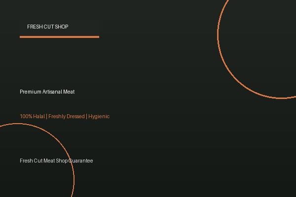

# Fresh Cut Meat Shop Management System
### Premium Retail Management Platform | Responsive Web Application | Future Mobile App Ready



---

## 1. Executive Summary

**Fresh Cut Meat Shop Management System** is a production-grade, full-stack retail management web application built with **Python Flask**, **Supabase PostgreSQL**, **Chart.js**, and modern responsive web technologies.

Designed specifically for fresh meat retail operations, the platform digitizes daily shop counter operations, eliminates manual arithmetic and stock maintenance errors, provides live customer ordering for shop pickup, and enforces strict role-based access controls across **three separate user experiences**:

1. **Owner / Admin Portal** (18 Comprehensive Business Management Sections)
2. **Employee Billing Counter Portal** (Fast, Touch-Friendly POS & Pickup Processing)
3. **Customer Storefront** (Artisanal Online Browsing & Collection Scheduling)

---

## 2. Distinctive Visual Theme & Design Identity

The platform adopts an artisanal, elegant retail design system crafted to replace generic templates:

| Palette Color | Hex Code | Purpose |
| :--- | :--- | :--- |
| **Deep Charcoal** | `#202522` | Primary text, executive sidebars, high-contrast headers |
| **Warm Ivory** | `#F7F4ED` | Page backgrounds, subtle cards, soothing paper-like aesthetic |
| **Muted Sage** | `#81917B` | Secondary accents, employee branding, stock adequacy badges |
| **Burnt Orange** | `#D97745` | Primary CTA buttons, price tags, notifications, active indicators |
| **Soft White** | `#FFFFFF` | Card surfaces, modals, content containers |

---

## 3. Strict Product Category & Unit Rules

Per the strict business requirements, the application supports **ONLY** these four product categories:

1. **Chicken Items** (Whole Curry Cut, Boneless Breast, Drumsticks, Keema, Natukodi, Liver & Gizzard)
2. **Mutton Items** (Goat Curry Cut, Boneless Prime Chunks, Keema, Chops/Chaap, Liver, Paya Trotters)
3. **Eggs** (Farm Fresh White 6/12/30, Organic Country Brown, Kadaknath Pure Black Eggs)
4. **Fish Items** (River Rohu, Catla, King Seer / Vanjaram, Jumbo Tiger Prawns, White Pomfret, Rawas Salmon)

### Measurement Units Supported
- **Kilograms (KG)**: Supports precision fractional decimal weights (e.g. `0.250 KG`, `0.500 KG`, `1.750 KG`).
- **Pieces (PCS)**: Enforced integer units for egg packs/trays and piece-based meat items (e.g. Mutton Paya).

---

## 4. Multi-Role Authentication & Security Architecture

### Real Database Authorization
Role selection on the login page does **not** determine permissions. Roles and user statuses are verified using protected database records in the `public.profiles` table and enforced on the server-side via Python Flask decorators (`@login_required`, `@role_required`, `@roles_allowed`) and PostgreSQL Row Level Security (RLS).

### Default Test Credentials (Seeded into Supabase)
| Portal / Role | Email | Password | Access Level |
| :--- | :--- | :--- | :--- |
| **Owner / Admin** | `owner@freshcut.com` | `Owner@123` | Full access to all 18 business management modules |
| **Shop Employee** | `employee@freshcut.com` | `Employee@123` | Counter POS billing, personal sales history, stock availability, pickup processing |
| **Customer** | `customer@freshcut.com` | `Customer@123` | Storefront browsing, cart, pickup checkout, order history |

*Note: New customers can register independently through `/auth/register/customer`. Employees can only be created by the Owner.*

---

## 5. System Features by Portal

### 5.1. Owner / Admin Dashboard (18 Navigation Sections)
1. **Dashboard**: 12 live KPI cards (Today's Sales, Today's Bills, Total Revenue, Total Expenses, Gross Profit, Net Operating Result, Total Products, Available Stock, Low Stock Alerts, Pending Orders, Customers, Employees) and 4 interactive Chart.js visualizations.
2. **Products Management**: Full catalog CRUD with category/unit restrictions, image URLs, and instant activation toggle.
3. **Price Management**: Live table for rapid selling price and cost price overrides with instant storefront sync and historical invoice immutability.
4. **POS / Billing**: High-speed touch-friendly counter billing terminal with auto totals, line item calculations, and instant receipt generation.
5. **Inventory Management**: Real-time stock valuation, low stock warnings, stock adjustments, and perishable spoilage/wastage logging with audit notes.
6. **Online Orders**: Order management pipeline (`Pending` → `Accepted` → `Ready for Collection` → `Completed` → `Cancelled`) with automated stock reservation.
7. **Customer Management**: Shopper directory, lifetime purchase spend, visit counts, and credit/balance tracking.
8. **Employee Management**: Staff account creation, employee code assignment, salary tracking, and deactivation controls.
9. **Supplier Management**: Directory of livestock breeders, broiler farms, and coastal fisheries with contact and balance ledgers.
10. **Purchase Management**: Incoming purchase orders with automatic stock replenishment, cost-price recalculation, and payment tracking.
11. **Expenses Management**: Daily operational overhead recording (`Shop rent`, `Electricity`, `Employee salaries`, `Transportation`, `Packaging`, `Maintenance`, `Other business expenses`).
12. **Payments Log**: Unified audit ledger of all cash/UPI receipts, vendor payouts, and expense disbursements.
13. **Sales History**: Complete searchable billing archive with date filters, printable thermal receipts, and downloadable PDF invoices.
14. **Reports & Analytics**: Comprehensive business intelligence (Daily/Product/Category/Employee Sales, Wastage Loss, Inventory Valuation, and Profit & Loss Statement) with **CSV and Excel (.xlsx)** exports.
15. **Shop Settings**: Store branding, currency symbol (`₹`), physical address, contact telephone, tax rate, and custom receipt footer notes.
16. **Audit Logs**: Immutable activity log recording all user actions, entity IDs, timestamps, and metadata payloads.
17. **Owner Profile**: Personal profile details and secure password change.
18. **Sign Out**: Safe session clearance.

### 5.2. Employee Billing Counter Portal
- **Operational Dashboard**: Quick metrics on today's personal sales, bills created, and pending pickup orders.
- **Counter POS**: Fast touch interface for adding items in KG or PCS, calculating subtotals, applying discounts, choosing Cash/UPI, and printing receipts.
- **My Sales History**: View and reprint invoices generated by the logged-in staff member.
- **Stock Availability**: Read-only real-time inventory balances and out-of-stock indicators.
- **Customer Pickup Orders**: Fulfill online orders by marking items `Ready for Collection` or `Completed`.
- **Restricted Access**: Strictly blocked by backend decorators from modifying prices, adding products, viewing financial profit reports, or managing employees.

### 5.3. Customer Storefront
- **Storefront Homepage**: Artisanal hero banner, shop introduction, 4 category cards, featured cuts, store hours, and contact details.
- **Catalog Browsing**: Responsive cards with high-definition product imagery, live prices from Supabase, availability badges, and Add-to-Cart buttons.
- **Shopping Cart**: Real-time item additions, fractional weight entries (KG) and whole piece inputs (PCS), subtotal calculation, and direct checkout.
- **Express Shop Collection**: Pickup window scheduling, optional butchery cutting instructions, and order confirmation.
- **Order Reference & History**: Unique reference numbers (e.g., `ORD-2026-0001`) with live preparation status (`Pending`, `Accepted`, `Ready for Collection`).

---

## 6. Database Architecture (Supabase PostgreSQL)

The relational database is normalized and configured on **PostgreSQL 17.12** hosted on Supabase:

### Primary Tables
1. `public.profiles`: Authentication identities and role permissions (`admin`, `employee`, `customer`).
2. `public.products`: Master catalog strictly constrained to the 4 categories and 2 units.
3. `public.customers`: Shopper directory, contact info, and outstanding balances.
4. `public.employees`: Staff records linked to profiles with employee codes and designations.
5. `public.sales`: Completed POS bill headers with invoice numbers and payment methods.
6. `public.sale_items`: Historical line items with captured unit price, unit cost, and line total.
7. `public.online_orders`: Customer storefront collection orders and status pipeline.
8. `public.online_order_items`: Line items for online pickup orders.
9. `public.inventory`: Real-time stock balances, reserved stock, and reorder alert thresholds.
10. `public.stock_movements`: Complete inventory ledger (`PURCHASE`, `SALE`, `ONLINE_ORDER`, `WASTAGE`, `DAMAGE`, `RETURN`, `ADJUSTMENT`).
11. `public.suppliers`: Livestock, poultry, and fisheries vendor directory.
12. `public.purchases`: Restocking purchase headers with supplier reference and amounts.
13. `public.purchase_items`: Line items for incoming purchase shipments.
14. `public.expenses`: Business operational expenses with mandatory categories.
15. `public.payments`: Financial transactions ledger (Receipts, Supplier payouts, Expense payouts).
16. `public.settings`: Store configuration, operating hours, and receipt footer message.
17. `public.audit_logs`: Detailed system audit records.

---

## 7. Future Mobile Application Readiness

The platform is designed as an **API-first shared backend**. Future iOS, Android, and PWA mobile clients can connect directly to the existing Flask REST API and Supabase database without duplicating business logic:

### Documented REST API Endpoints (`/api/v1/`)
| Endpoint | Method | Description | Auth Required |
| :--- | :--- | :--- | :--- |
| `/api/v1/categories` | `GET` | Returns the 4 allowed categories and units | No |
| `/api/v1/products` | `GET` | List active products with category & search filters | No |
| `/api/v1/products/<id>` | `GET` | Product details and current available stock | No |
| `/api/v1/cart/validate` | `POST` | Validates cart items, verifies stock, and recalculates totals | No |
| `/api/v1/orders` | `POST` | Places an online shop pickup order | Optional |
| `/api/v1/orders` | `GET` | Retrieves customer orders or all orders for staff | Yes (JWT) |
| `/api/v1/pos/bill` | `POST` | Executes atomic POS billing and stock decrement | Yes (Staff/Admin) |
| `/api/v1/inventory` | `GET` | Returns stock status and low-stock alerts | Yes (Staff/Admin) |
| `/api/v1/shop-settings` | `GET` | Retrieves public shop address, contact, and hours | No |
| `/auth/api/login` | `POST` | Authenticates user and returns JWT Bearer Token | No |
| `/auth/api/register` | `POST` | Customer registration returning JWT Bearer Token | No |

---

## 8. Installation & Local Development Setup

### Prerequisites
- Python 3.10+
- Active Internet connection (for Supabase PostgreSQL pooler connection)

### Setup Steps
```bash
# 1. Clone the repository
git clone https://github.com/viswanath-kummari/website.git
cd website

# 2. Create and activate a Python virtual environment
python -m venv venv
# On Windows:
venv\Scripts\activate
# On Linux/macOS:
source venv/bin/activate

# 3. Install dependencies
pip install -r requirements.txt

# 4. Configure environment variables
# Copy .env.example to .env and configure your Supabase credentials:
cp .env.example .env

# 5. Run automated test suite
python run_tests.py
python test_routes.py

# 6. Start the development server
python run.py
```

The application will be accessible at:
- **Customer Storefront:** `http://localhost:5000/`
- **Authentication Portal:** `http://localhost:5000/auth/landing`
- **Owner Dashboard:** `http://localhost:5000/auth/login/owner`
- **Employee POS Terminal:** `http://localhost:5000/auth/login/employee`

---

## 9. Verification & Testing Results

All 12 core service test cases and all 32 web route views have been verified against the live Supabase PostgreSQL database:

```
======================================================================
RUNNING FRESH CUT MEAT SHOP TEST SUITE
======================================================================
  [PASS] Auth: Password Hashing & Bcrypt Verification
  [PASS] Auth: JWT Generation for Mobile & REST API
  [PASS] Auth: Owner Sign In & Role Verification
  [PASS] Auth: Employee Sign In & Role Verification
  [PASS] Auth: Role Mismatch Rejection
  [PASS] Auth: Invalid Password Rejection
  [PASS] POS: Bill Creation & Atomic Stock Deduction
  [PASS] POS: Overselling Prevention Check
  [PASS] API: Strict 4 Categories Endpoint
  [PASS] API: Products Catalog Endpoint
  [PASS] API: Cart Live Validation Endpoint
  [PASS] API: Shop Settings Endpoint
======================================================================
RESULTS: 12 PASSED, 0 FAILED (TOTAL 12)
======================================================================

--- Route Testing ---
  [OK] Storefront Home (/) -> 200
  [OK] Catalog (/products) -> 200
  [OK] Cart (/cart) -> 200
  [OK] Checkout (/checkout) -> 200
  [OK] Login Landing (/auth/landing) -> 200
  [OK] Owner Login (/auth/login/owner) -> 200
  [OK] Employee Login (/auth/login/employee) -> 200
  [OK] Customer Login (/auth/login/customer) -> 200
  [OK] Customer Register (/auth/register/customer) -> 200
  [OK] All 17 Admin Dashboard Sections -> 200
  [OK] All 6 Employee Portal Sections -> 200
  [OK] Employee Forbidden Access to Admin Dashboard -> 302 Redirect
========================================================
ALL ROUTES VERIFIED AND FUNCTIONAL!
========================================================
```

---

## 10. Repository Structure

```
├── .env.example              # Template environment configuration
├── .gitignore                # Git ignore rules (protecting .env and secrets)
├── requirements.txt          # Python project dependencies
├── run.py                    # Application launch entrypoint
├── run_tests.py              # Automated backend test runner
├── test_routes.py            # Automated web route verification
├── README.md                 # Complete platform documentation
├── database/
│   ├── schema.sql            # Normalized PostgreSQL DDL schema
│   ├── policies.sql          # Row Level Security (RLS) policies
│   └── seed.sql              # Initial products, accounts, and inventory
└── backend/
    ├── app/
    │   ├── __init__.py       # Application factory & Jinja filters
    │   ├── config.py         # App configuration & business rules
    │   ├── db.py             # Threaded database connection pool
    │   ├── routes/
    │   │   ├── auth_routes.py     # Login, registration, session management
    │   │   ├── customer_routes.py # Storefront, catalog, cart, checkout
    │   │   ├── employee_routes.py # Staff counter POS, sales, stock, orders
    │   │   ├── admin_routes.py    # 18 owner navigation sections
    │   │   └── api_routes.py      # REST API endpoints for future mobile app
    │   ├── services/
    │   │   ├── auth_service.py     # Bcrypt authentication & JWT
    │   │   ├── product_service.py  # Product catalog CRUD & price sync
    │   │   ├── pos_service.py      # Atomic billing & stock reduction
    │   │   ├── inventory_service.py# Stock adjustments, wastage tracking
    │   │   ├── order_service.py    # Online orders pipeline & reservation
    │   │   ├── customer_service.py # Customer directory & lifetime spend
    │   │   ├── employee_service.py # Staff management & sales volume
    │   │   ├── supplier_service.py # Vendors, purchases & auto-stocking
    │   │   ├── expense_service.py  # Operating overheads & payment ledger
    │   │   ├── report_service.py   # Business intelligence & P&L statements
    │   │   └── settings_service.py # Shop configuration & audit logs
    │   └── utils/
    │       ├── decorators.py       # Role verification & token checking
    │       └── export_helpers.py   # PDF invoice, Excel, and CSV generators
    ├── static/
    │   ├── css/
    │   │   └── theme.css           # Premium Deep Charcoal & Burnt Orange theme
    │   ├── js/
    │   │   ├── app.js              # Global notifications & validation
    │   │   ├── pos.js              # High-speed POS billing engine
    │   │   ├── cart.js             # Customer storefront shopping cart
    │   │   └── charts.js           # Chart.js business analytics charts
    │   └── images/                 # 25 high-resolution product & hero images
    └── templates/
        ├── base.html               # Master layout with navbar & footer
        ├── 403.html, 404.html, 500.html # Error templates
        ├── auth/                   # Landing, Owner, Employee, Customer screens
        ├── customer/               # Home, catalog, cart, checkout, confirmation
        ├── employee/               # Staff layout, dashboard, POS, stock, orders
        └── admin/                  # Owner layout, dashboard, products, prices, etc.
```

---

## 11. License

This project is proprietary software developed for **Fresh Cut Meat Shop**. All rights reserved.
